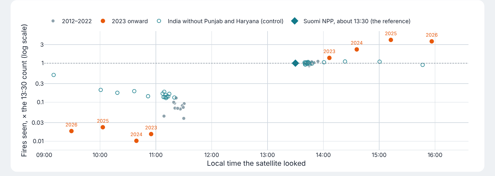
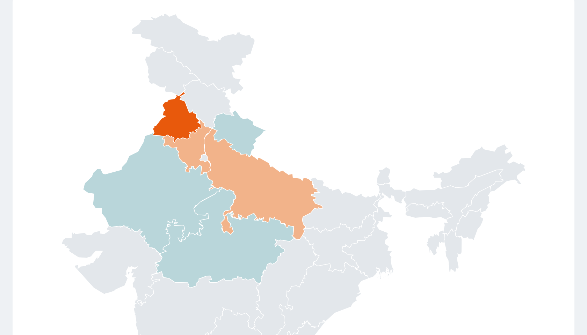

# AgniCal

**Punjab and Haryana's farm fires moved later in the day, and NASA's fire counts didn't follow.**

[](https://prithika-97.github.io/agnical/)


NASA Space Apps Challenge 2026, challenge: *Harmonization of MODIS and VIIRS Hot Spots*.
**[Open the live site](https://prithika-97.github.io/agnical/)**

<p align="center"></p>

*Each dot is one season seen by Terra (morning) or Aqua (afternoon), as a multiple of the early-afternoon count. Teal rings are every state outside Punjab and Haryana: they stay on the old curve while Punjab leaves it.*

## The finding in 30 seconds

- NASA's polar satellites pass India at fixed hours. Terra and Aqua's passes have drifted, and in
  Punjab and Haryana the burning has moved to the late afternoon.
- Of the 13 Indian states with enough fires to test, **only Punjab and Haryana** show the shift.
  The same satellites see no such change across the border in Pakistan or in the other states, so
  it is not an orbit-drift artefact.
- Suomi NPP's count says burning fell 95% from its 2016 peak. Aqua's later pass puts a floor
  under that: the fall is **no more than about 83%**.
- AgniCal turns this into a tested record (2003-2025, one scale), a region checker anyone can run on
  their own FIRMS files, a district blind-spot index, and a conversion test that says where a fixed
  MODIS-to-VIIRS mapping can still be trusted.

## What is and isn't new

Farmers burning later is **not my discovery**. Jethva (2026, *Remote Sensing*), Singh et al. (ISRO SAC,
2025) and iFOREST (2025) showed it with satellites that watch all day and with burnt-area maps. I ask what it means for the
combined MODIS-VIIRS record that everyone uses, and whether NASA's polar data can show it on their own.

| Added here | Where |
|---|---|
| One MODIS-to-VIIRS scale for 2003-2025, with uncertainty | `agnical/harmonize.py` |
| Two indicators that flag seasons where the count stops being comparable | `agnical/diurnal.py` |
| Controls: Pakistani Punjab strip, all unflagged Indian states, near-nadir, VIIRS-only | `agnical/controls.py` |
| The same test on every Indian state and season, including the season under way | `agnical/national.py` |
| The drifting-satellite scanner: Terra and Aqua as two extra looks at the fire day | `docs/index.html` |
| A floor under the real count, cross-checked against a published geostationary estimate | `agnical/controls.py` |
| Where a fixed Aqua-to-VIIRS conversion holds across India | `scripts/harmonize_india_test.py` |
| A checker that runs the test on any FIRMS files, in the browser | `docs/index.html` |

<p align="center"></p>

<details>
<summary><b>Detailed results</b> (everything below is computed by the pipeline)</summary>

### Punjab and Haryana against the border strip (`pipeline.py`, `reports/RESULTS.md`)

| | Punjab + Haryana, India | Punjab, Pakistan (border strip) |
|---|---|---|
| Suomi NPP daytime fires, 2025 vs 2012-22 average | -94% | -5% |
| Aqua fires per Suomi NPP fire, 2025, x its 2012-22 level | 3.6 | 1.0 |
| Share of fires seen on the night pass, 2025, x its 2012-22 level | 34 | 1.5 |
| Terra per Aqua fire, 2025, x its 2012-22 level (**not used**) | 0.08 | 0.02 |

- Relative to the comparison region, the Aqua ratio on the Indian side is **3.7x** in 2025
  (95% interval 2.5-5.4) and 2.0x in 2024 (1.4-2.9). The night share is 23x (15-38) and
  10.5x (7.4-15).
- **2023 is the weakest year**: against the narrow Pakistan strip, Aqua's ratio rose as much on
  both sides (0.92, 0.68-1.20), so only the night share separates them; 2024 and 2025 are
  confirmed. Against the larger all-India control (below) 2023 is distinguishable on both, so
  I read it as the first, smaller step of the shift.
- **A signal I threw out**: the morning (Terra) to afternoon (Aqua) ratio collapsed on both
  sides of the border, so it reflects orbit drift, not burning.
- **A test that found nothing**: within VIIRS's own window (two looks ~100 min apart on some
  days) the rise per hour stayed inside its 2012-2022 range. What still burns at midday keeps
  its old shape; the change lies after the window.
- **Viewing angle** does not explain it: with near-nadir detections only, the Aqua ratio in
  2025 is 3.2x its old level (3.6x with all detections).
- **Floor**: in 2025 Suomi NPP counted about 4,600 daytime fires (1 Oct - 30 Nov). At Aqua's
  hour (15:15) it would have counted about 16,600 (14,900-18,900). Against the 2016 peak the
  count says -95%; the floor says no more than about -83%. iFOREST's Sentinel-2 burnt area for
  Punjab fell 36% between 2022 and 2025.

### All of India (`national_pipeline.py`, 8.0 million detections, 2003-2026)

The same two indicators for every state and three burning seasons. Each state is compared with
the states that show no flag, which are seen by the same drifting satellites.

- **Post-monsoon 2025: of 13 states with enough fires to test, only Punjab and Haryana show a
  timing break.** No state shows one in the pre-monsoon or winter season.
- Against unflagged states, 2025: Punjab's Aqua ratio is 3.5x (95% interval 2.3-5.2) and its
  night share 79x (47-128); Haryana's are 1.9x (1.3-2.4) and 29x (23-39).
- With this larger control, 2023 is also confirmed for both states (Punjab Aqua ratio 1.4x,
  1.1-1.7), which the narrow Pakistan strip could not settle.
- **What the orbit drift does on its own**: in unflagged states Aqua's ratio stands at 1.13x
  its 2012-2022 level in the 2025 post-monsoon season (1.06x pre-monsoon, 1.01x winter).
- Watch list (one indicator only): Uttar Pradesh post-monsoon in all three years; Gujarat
  pre-monsoon 2025 (Aqua ratio 2.1x unflagged states, 1.5-2.8); Haryana winter night share.

### New in this project

- **This season, in every state** (1 Oct - 2 Nov 2026, near-real-time data, judged against the
  same weeks of 2012-2022): the break is still there. Punjab's Aqua ratio is 3.4x its old
  level and 4.0x that of unflagged states (95% interval 2.1-5.9); its night share is 64x.
- **District blind-spot index**: Aqua's later count in Suomi NPP units divided by the count,
  2024-25. It is 4.8x in Mansa (count -92% against 2017-21, floor no more than -63%), 3.4x in
  Sangrur, and 1.1x in Jalandhar. No intervals at this level; read the pattern.
- **Check your own region**: the website runs the same test in the browser on FIRMS archive
  CSVs for any area on Earth, or on any Indian state and any months.

### Harmonization (leave one season out, 2012-2022)

| Method | Cell deviance | Paddy total error | Wheat total error | Paddy peak period exact |
|---|---|---|---|---|
| One regional ratio | 7.29 | 5.5% | 22.5% | 55% of seasons |
| Per-cell ratio | 7.29 | 5.3% | 22.8% | 64% |
| LightGBM, Poisson | 0.93 | 6.6% | 14.2% | 91% |

For the paddy-season regional total a simple ratio is as good as the model (paired Wilcoxon
p = 0.32); all methods miss the same seasons. The model is better where a ratio cannot be:
cell-level maps, the timing of the seasonal peak, and the wheat season (p = 0.03).

Suomi NPP stopped delivering data on 2 Nov 2026. NOAA-21 counts convert to Suomi NPP units by
a factor of 1.03 (yearly range 1.01-1.12, 2023-2025).


</details>

## Run it

```bash
pip install -r requirements.txt
# put NASA FIRMS archive CSVs in data/raw/ (MODIS C6.1 and VIIRS S-NPP, NOAA-20, NOAA-21)
python pipeline.py            # about 3 minutes; writes data/processed, reports/ and docs/data
python national_pipeline.py   # all-India run; needs FIRMS country downloads for India in data/raw_india/
python -m http.server -d docs # then open http://localhost:8000
pytest -q
```

The website in `docs/` is static (HTML, JSON, Plotly.js) and is served as-is by GitHub Pages.
The harmonized record is one file: `docs/data/agnical_record.csv`.

## Repository layout

```
agnical/            analysis modules (ingest, grid, harmonize, diurnal, controls, national, export)
pipeline.py         Punjab + Haryana run: harmonized record, timing analysis, site data
national_pipeline.py  all-India run
scripts/            one-off helpers (reduce_snpp.py, harmonize_india_test.py)
docs/               the website (static; served by GitHub Pages) and docs/data/*.json, agnical_record.csv
reports/            RESULTS.md, written from the computed metrics
tests/              pytest suite (19 tests)
assets/             images used in this README
```

## Method

| Step | Module | What it does |
|---|---|---|
| Ingest | `agnical/ingest.py` | Reads FIRMS archive and near-real-time files, keeps vegetation fires, drops low confidence, prefers standard over NRT data per satellite and day. |
| Borders | `agnical/regions.py` | Keeps detections inside Punjab and Haryana (geoBoundaries) and tags each with its district. |
| Controls | `agnical/controls.py` | Comparison regions; difference-in-differences with a day-level bootstrap; near-nadir check; late-view floor; VIIRS-only window test; VIIRS hand-over factor. |
| Time of day | `agnical/diurnal.py` | One row per satellite pass; n ~ Poisson(exp(a_day + b_sensor - (t - mu_year)^2 / 2 sigma_year^2)), with a_day removed by conditioning on each day's total; day-level bootstrap. Reports a peak only where viewing times bracket it. Timing-break test on two indicators (robust z > 3 on both). |
| One scale | `agnical/grid.py`, `agnical/harmonize.py` | 0.1 degree cells x 8-day periods; LightGBM (Poisson) predicts Suomi NPP counts from MODIS features; trained on 2012-2022 only; leave-one-season-out validation against two ratio baselines; drift test on 2023 onward. |
| Outputs | `agnical/export.py`, `agnical/report.py` | Write the JSON and CSV the website reads and `reports/RESULTS.md`. No number on the site is typed by hand. |

To run another region, change `BBOX` in `agnical/config.py` and the two boundary files built
by `regions.build_boundary_file` and `controls.build_region_file`.

## Limitations

- In the all-India run, Suomi NPP detections are pre-counted per 0.1 degree cell (`scripts/reduce_snpp.py`, to move the file over a slow connection) and assigned to the state of the cell centre, so a small share of fires near state borders is assigned to the neighbour. View angle and the VIIRS-only test are therefore not repeated nationally.

- Active-fire detections are snapshots, not burned area; cloud, haze and short fires between passes are missed.
- Polar satellites cannot see burning after about 15:15. The floor is a lower bound, not an estimate of the total. I did not obtain geostationary fire data during the hackathon; the 16:00-18:00 peak is quoted from published studies.
- The comparison region is a narrow strip with about a tenth of the study area's fires. It controls for the satellites, not for weather or crop-calendar differences.
- Both indicators use Suomi NPP's daytime count, so they are not fully independent.
- The timing test covers India only. It has not been run on other countries.
- District borders are from 2021 (before Malerkotla and Charkhi Dadri).
- 2026 near-real-time files have no fire-type field, so a few static heat sources may remain.

## Data and credits

- NASA FIRMS active fire data (MODIS C6.1; VIIRS 375 m): https://firms.modaps.eosdis.nasa.gov
- geoBoundaries gbOpen IND: states (DataMeet / Election Commission of India, CC BY 2.5 IN), districts (Pathways Data / lgdirectory.gov.in, ODbL 1.0)
- Jethva, H. (2026). Timing the Flames: Geostationary Satellite Detection of Diurnally Shifting Stubble Burning in Northwestern India. *Remote Sensing* 18(10), 1506. https://doi.org/10.3390/rs18101506
- Singh, N., Pradhan, R., Shukla, B. P., Pandya, M. R. (Space Applications Centre, ISRO), communication in *Current Science*, 2025, as reported by The Tribune, 10 Dec 2025.
- iFOREST (2025). Stubble Burning Status Report 2025, as reported by The Tribune, 9 Dec 2025.

## Cite

If you use the record or the test, please cite this repository (see `CITATION.cff`).

## License

MIT. NASA FIRMS data and the boundary files keep their own licenses (see above).

## Use of AI

Code and text were drafted with Claude (Anthropic) and reviewed, run and checked by the author.
All figures are computed from NASA data by this pipeline. No AI-generated images or data are used.

## Outside check

Jethva (2026, Remote Sensing 18(10) 1506) used Korea's hourly GK-2A satellite and estimated, roughly, that VIIRS missed about 56% of fires in 2024 and 64% in 2025 in northwest India. AgniCal's lower bound from polar data alone is 52% (2024) and 72% (2025). They agree in size and in the rise; the published figure is a rough trend-based estimate over a different box, so exact agreement is not expected. AgniCal never used GK-2A data.
